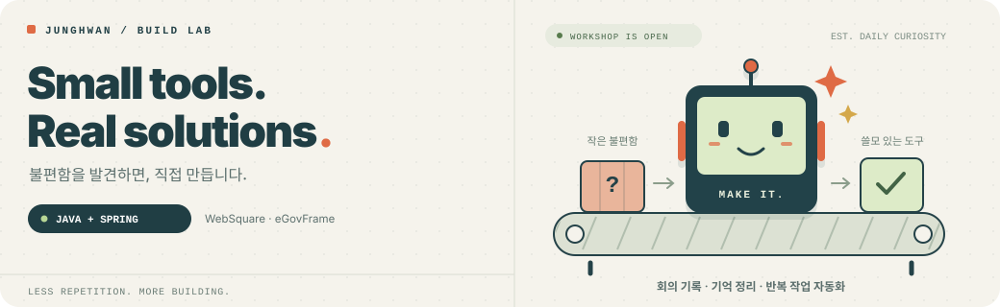

# 김정환

**Software Engineer · Java & Spring**

Java·Spring, WebSquare, 전자정부프레임워크를 다룹니다.  
필요한 도구는 직접 만들고, 반복되는 작업은 자동화합니다.

[↗ 개발 노트 · freedom.log](https://velog.io/@freedom_0602) · [↗ GitHub](https://github.com/jhkim0602)

## Experiences

| 기간 | 회사 | 직무 |
| :--- | :--- | :--- |
| 2026.10.01 ~ ing | **acanet** | 소프트웨어 엔지니어 |

## Projects

작은 불편함에서 시작한 도구와, 함께 만든 서비스들.

| 프로젝트 | 소개 |
| :--- | :--- |
| 🧭 [**WhyYou**](https://github.com/jhkim0602/gbsa_aws) | 기업의 평가 기준과 지원자 경험을 연결하는 근거 기반 AI 면접·채용 지원 플랫폼 |
| 🧩 [**Dibut**](https://github.com/jhkim0602/debut-aws) | AI 모의면접과 실시간 협업 기능을 제공하는 개발자 취업 준비 플랫폼 |
| 🐾 [**Monguri AI Career**](https://github.com/jhkim0602/monguri_AWS) | 채용공고 분석·자소서 작성·RAG 모의면접·코칭 리포트를 연결한 커리어 서비스 |
| 📑 [**Vizabridge**](https://github.com/jhkim0602/-Vizabridge-IT-AI-) | 비자·체류 매뉴얼을 출처 확인과 검수가 가능한 구조화 데이터로 변환하는 파이프라인 |
| 🎙️ [**Meeting Scribe**](https://github.com/jhkim0602/meeting-scribe) | 실시간 받아쓰기·메모·수정부터 회의록 내보내기까지 지원하는 로컬 회의 기록 앱 |
| 🧠 [**seCall**](https://github.com/jhkim0602/seCall) | AI 에이전트와의 대화를 수집해 검색 가능한 로컬 위키로 정리하는 도구 |
| ⚡ [**Dev Event Automation**](https://github.com/jhkim0602/Dev-Event-in-discord-webhook) | 개발 행사를 수집하고 AI로 요약해 Discord에 게시하는 자동화 도구 |
| 🧱 [**StackLoad**](https://github.com/jhkim0602/StackLoad) | 개발자를 위한 기술 스택 정보·커뮤니티 플랫폼 |

🔧 작업실 서랍 열어보기

**반복 작업을 대하는 자세**

한 번은 직접 합니다. 두 번이면 고민합니다. 세 번째부터는 도구를 만듭니다.  
가끔은 도구를 만들다가 프로젝트가 하나 더 생깁니다.

